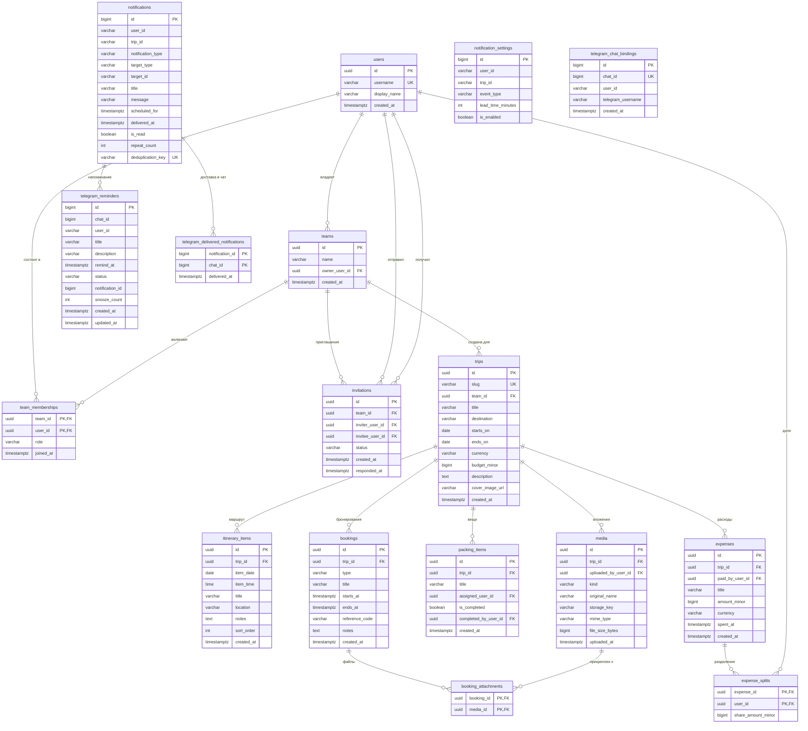

# База данных TravelSplit (PostgreSQL)

## Архитектура и ER-модель



## Описание таблиц

### 1. `users`
Пользователи сервиса. Уникальный логин без учета регистра `LOWER(username)`.

### 2. `teams` и `team_memberships`
Группы участников поездок. Связь многие-ко-многим между пользователями и командами с ролью (`ORGANIZER`, `MEMBER`).

### 3. `invitations`
Приглашения в команду по username. Статусы: `PENDING`, `ACCEPTED`, `DECLINED`. Ограничение `chk_invitation_not_self` исключает отправку приглашения самому себе.

### 4. `trips`
Поездки с датами, валютой, бюджетом в минимальных единицах (`budget_minor`), описанием и обложкой. Ограничение `ends_on >= starts_on`.

### 5. `itinerary_items`
План поездки по дням со временем и сортировкой `sort_order`.

### 6. `bookings`
Бронирования жилья, билетов и транспорта.

### 7. `packing_items`
Списки вещей в дорогу с отметкой выполнения и назначенным участником.

### 8. `expenses` и `expense_splits`
Фиксация расходов. Суммы хранятся в целых минимальных единицах (`amount_minor`, `share_amount_minor` — копейки/центы) для исключения погрешностей чисел с плавающей точкой. Участники сплита и их доли выделены в таблицу `expense_splits`.

### 9. `media` и `booking_attachments`
Метаданные загруженных фото и документов с привязкой к поездкам и бронированиям.

### 10. `v_user_trip_balances`
Представление (SQL View) для автоматического расчета баланса каждого участника в поездке:
- `total_paid_minor`: сумма всех расходов, оплаченных участником;
- `total_share_minor`: сумма долей участника во всех расходах;
- `balance_minor`: чистый баланс (`total_paid_minor - total_share_minor`).

### 11. `notifications`
Уведомления пользователей по событиям поездок. Уникальный `deduplication_key` предотвращает дубли. При вставке новой записи триггер `trg_notifications_after_insert` вызывает `pg_notify('new_notification', ...)` для мгновенной доставки в Telegram-бот.

### 12. `notification_settings`
Пользовательские настройки времени упреждения (`lead_time_minutes`) и включения/отключения типов уведомлений по конкретной поездке.

### 13. `telegram_chat_bindings`
Привязки Telegram `chat_id` к логину пользователя (`user_id`).

### 14. `telegram_reminders` и `telegram_delivered_notifications`
Персональные напоминания пользователей в Telegram (включая snooze) и журнал идемпотентной доставки записей из `notifications` в конкретный Telegram-чат.

## Локальный запуск через Docker Compose

Запуск чистой базы данных с автоматическим накатом схемы:

```bash
docker compose up -d
```

Проверка статуса контейнера:

```bash
docker compose ps
```

Подключение к базе данных через psql в контейнере:

```bash
docker compose exec -it postgres psql -U travelsplit -d travelsplit
```

Остановка контейнера:

```bash
docker compose down
```

Остановка с удалением volume:

```bash
docker compose down -v
```

## Параметры подключения

| Параметр | Значение |
| --- | --- |
| Host | `127.0.0.1` |
| Port | `5432` |
| Database | `travelsplit` |
| Username | `travelsplit` |
| Password | `travelsplit` |
| JDBC URL | `jdbc:postgresql://127.0.0.1:5432/travelsplit` |

## Расположение миграций

- DDL-схема: `backend/database/schema.sql`
- Базовая миграция: `backend/src/main/resources/db/migration/V1__init_schema.sql`
- Уведомления и Telegram-бот: `backend/src/main/resources/db/migration/V2__notifications_and_telegram.sql`
